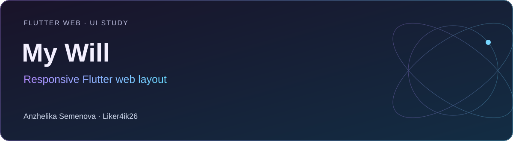

# My Will

**Flutter Web · UI study** · Flutter Web · Dart · adaptive_layout · flutter_svg

Учебный интерфейс на Flutter Web с отдельными представлениями для мобильной и широкой версии экрана.

[Портфолио автора](https://portfolio.semenova-anzhelika.online/) · [Профиль GitHub](https://github.com/Liker4ik26) · [Исходники](https://github.com/Liker4ik26/my_will/tree/master)

## Что в проекте

- Адаптивная компоновка через adaptive_layout.
- Раздельные мобильные и десктопные элементы навигации.
- Собственные варианты header и footer.
- Локальные изображения, SVG и шрифты.

## Технологии

| Направление | Реализация |
| :--- | :--- |
| Стек | Flutter Web · Dart · adaptive_layout · flutter_svg |
| Формат | Flutter Web · UI study |
| Окружение | Flutter с Dart >=2.19.6 <3.0.0: требуется совместимая историческая версия SDK |

## Где смотреть код

- lib/pages/desktop/ — широкая компоновка
- lib/pages/mobile/ — мобильная компоновка
- lib/pages/home_page.dart — выбор адаптивного представления

## Как запустить

Требования: Flutter с Dart >=2.19.6 <3.0.0: требуется совместимая историческая версия SDK.

```bash
git clone --branch master https://github.com/Liker4ik26/my_will.git
cd my_will
flutter pub get
```

```bash
flutter run -d chrome
```

## English overview

**My Will — Responsive Flutter web layout.**

Flutter Web · UI study. Stack: Flutter Web · Dart · adaptive_layout · flutter_svg. [Explore my professional portfolio](https://portfolio.semenova-anzhelika.online/).

---

**Автор — Анжелика Семёнова · [Liker4ik26](https://github.com/Liker4ik26)**

[Сайт](https://portfolio.semenova-anzhelika.online/) · [Telegram](https://t.me/Liker4ik50) · [Почта](mailto:pr110oat18@gmail.com)
